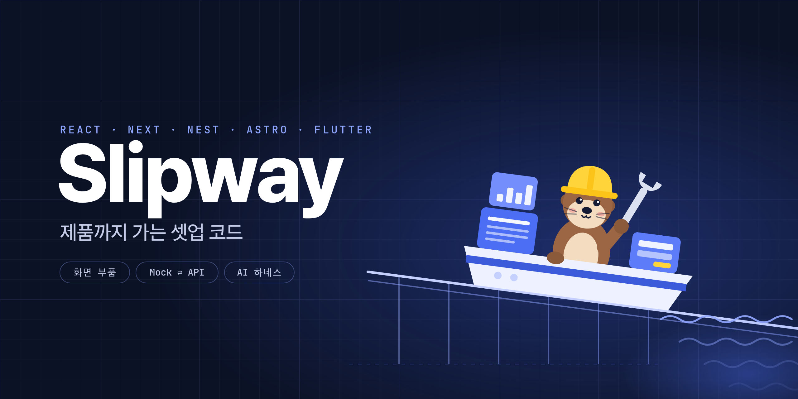

<p align="center">
  
</p>

<p align="center">
  <b>React · Next · NestJS · Astro · Flutter 셋업 코드와 화면 부품</b><br>
  서버 없이 첫 화면을 띄우고, 같은 코드로 제품까지 갑니다.
</p>

<p align="center">
  
  
  
  
  
  
  
  <a href="LICENSE"></a>
</p>

<p align="center">
  <a href="#사용법">사용법</a> ·
  <a href="#어떻게-돌아가나">구조</a> ·
  <a href="#리소스-생성">리소스 생성</a> ·
  <a href="#화면-조립">화면 조립</a> ·
  <a href="#디자인-하네스">디자인 하네스</a> ·
  <a href="#품질-관문">품질 관문</a> ·
  <a href="#프리셋">프리셋</a> ·
  <a href="#자주-묻는-것">FAQ</a>
</p>

## 특징

- **바로 실행.** 서버, DB, API 키 없이 브라우저 Mock API로 뜹니다. 로그인(이메일·게스트·카카오·네이버)까지 동작합니다.
- **제품까지 같은 코드.** Mock과 NestJS 서버가 같은 `/api/*` 계약을 씁니다. 환경 변수 하나로 실제 서버에 붙고, 화면과 테스트는 그대로입니다.
- **명령 하나로 DB·API.** `pnpm gen resource`가 필드 목록 하나로 테이블·마이그레이션·API·Mock·조회 훅·계약 테스트를 만듭니다.
- **화면은 부품으로.** 완성된 화면은 넣어 두지 않습니다. 앱 틀, 로그인, 표, 필터, 차트, 보드, 폼 등 23개 부품으로 조립합니다.
- **한국어 기본값.** 전화번호·사업자번호·금액·주소 입력, 한국어 검증 메시지, 어절 단위 줄바꿈, Pretendard.
- **품질 관문.** 접근성·대비·포커스·커서·넘침 검사, 번들 예산, Lighthouse 점수, CSP·요청 제한·운영 모드 보호가 `pnpm verify`와 CI에 있습니다.
- **어디든 배포.** 정적 호스팅, 컨테이너(Docker 선택), Node 직접 실행, VPS 한 대. Vercel, Cloudflare, Railway, AWS, iwinv.
- **AI와 같이 쓰는 하네스.** `AGENTS.md`(Claude Code는 `CLAUDE.md`로 같은 파일을 읽음), 디자인 하네스(모바일 앱 k-style-ui-ux, 웹 Impeccable) 연결, `REQ-n` 추적, `pnpm shots` 캡처, Claude Code 플러그인.

## 사용법

Slipway는 도구 상자입니다. 앱은 Slipway 밖, 지정한 폴더에 독립 프로젝트로 만들어지고 각자 자기 레포가 됩니다.
화면은 미리 만들어 두지 않습니다. 부품을 쓰는 사람이나 AI가 요구에 맞게 조립합니다.

명령을 외울 필요는 없습니다. "주문 목록 화면 만들어 줘", "예약 테이블 추가해 줘", "Vercel에 올려 줘"처럼 말하면 맞는 스킬이 잡힙니다.
새 프로젝트에는 화면·리소스·배포 스킬이 `.claude/skills/`에 들어 있어 플러그인을 설치하지 않아도 되고,
Slipway 레포에서 "Slipway로 ○○ 앱 만들어 줘"라고 하면 앱 만들기 스킬이 잡힙니다. Codex·Cursor는 `AGENTS.md`가 같은 스킬 파일을 가리킵니다.

### 1. Claude Code 플러그인 (추천)

```
/plugin marketplace add wooinwoo/slipway
/plugin install slipway@slipway
```

```
/slipway:new 필라테스 예약 앱. 회원은 수업을 예약하고 강사는 일정과 출석을 관리해
/slipway:screen 강사용 오늘 수업 목록. 예약 인원과 출석 체크
/slipway:resource 수업 후기. 별점과 내용
/slipway:deploy Vercel에 웹, Railway에 API
```

| 명령 | 하는 일 |
|---|---|
| `/slipway:new` | 무엇을 만들지, 프리셋, 디자인 하네스, 배포 대상을 한 번에 묻습니다. Slipway 옆 폴더에 프로젝트를 만들고, 데이터 층을 생성하고, 하네스로 `PRODUCT.md`·`DESIGN.md`를 정한 뒤 화면을 만들고 검증합니다 |
| `/slipway:screen` | 화면 하나를 만듭니다. 기능은 부품과 데이터 훅으로 조립하고 `REQ-n`·E2E를 붙입니다. 모양은 디자인 하네스(모바일 앱은 k-style-ui-ux, 웹은 Impeccable)로 짓고 다듬은 뒤, 캡처 확인·`check:ui`·실제 클릭까지 합니다 |
| `/slipway:resource` | 요청에서 필드를 뽑아 `pnpm gen resource`로 데이터 층을 만들고 화면에 연결합니다 |
| `/slipway:deploy` | 정적, 컨테이너, VPS, 웹·API 분리 중에서 고르고 설정 파일과 환경 변수를 준비합니다. 올리기 전에 확인을 받습니다 |

디자인은 [디자인 하네스](#디자인-하네스)가 맡습니다.

### 2. 다른 AI 도구 (Codex, Cursor 등)

Slipway를 받은 폴더에서 "Slipway로 ○○ 앱 만들어 줘"라고 합니다. 루트 `AGENTS.md`에 같은 흐름이 있습니다.
먼저 묻고, 옆 폴더에 생성하고, 데이터 층을 만든 뒤 화면을 조립하고 검증합니다. 만들어진 프로젝트 안에서는 그 프로젝트의 `AGENTS.md`를 따릅니다.

### 3. 직접

```sh
git clone https://github.com/wooinwoo/slipway && cd slipway
node scripts/create-project.mjs ../my-app --name "주문 관리" --tagline "주문부터 배송까지"   # --preset 기본 react
cd ../my-app
corepack pnpm install --frozen-lockfile
corepack pnpm gen resource orders 주문 --fields "title:text:주문명 amount:won:금액 status:enum(접수|배송중|완료):상태"
corepack pnpm dev                     # http://localhost:5173, Mock API
```

그다음 화면을 부품으로 만들고([화면 조립](#화면-조립)), `pnpm shots`로 캡처를 보고, `pnpm verify`로 검증합니다.
GitHub에 올리면 `.github/workflows/verify.yml`이 같은 검증에 Lighthouse와 의존성 검사를 더해 돌립니다.

필요한 것: Node.js 22.23.4 이상, pnpm 10.33.2(`corepack enable`). 브라우저 테스트는 처음 한 번 `pnpm exec playwright install firefox`. flutter 프리셋은 Flutter SDK.

## 어떻게 돌아가나

```
slipway/                                  도구 상자 (이 레포). 앱 코드는 여기에 쌓이지 않습니다
├─ templates/{react,next,mono,nest,astro,flutter}
├─ scripts/create-project.mjs             프리셋을 복사해 독립 프로젝트를 만듭니다
├─ scripts/gen.mjs                        리소스 생성기 (새 프로젝트에 scripts/gen.mjs로 복사됨)
├─ scripts/pack.mjs                       기존 프로젝트에 부품만 골라 복사
└─ plugin/                                Claude Code 플러그인 (/slipway:*)

my-app/                                   만들어진 프로젝트 (react 프리셋). 자기 레포
├─ src/
│  ├─ config.ts                           이름·소개, Mock 여부(isDemo)
│  ├─ index.css                           테마 토큰. --brand-h, --brand-c 두 숫자로 전체 색이 바뀜
│  ├─ patterns/                           Slipway 부품 23개 (app-shell, auth-forms, advanced-table …)
│  ├─ components/ui/                      shadcn 컴포넌트 전체
│  ├─ api/                                client.ts(JSON·토큰·필드 오류), auth.ts, <resource>.ts(생성)
│  ├─ mocks/                              브라우저 Mock API (MSW). handlers/<resource>.ts(생성)
│  ├─ lib/                                kr.ts(한국어 포맷·검증), csv, 필터·날짜 모델
│  └─ routes/                             __root, 빈 /, /auth/callback만. 화면은 여기에 조립
├─ e2e/  fixtures/parts/  parts-tests/    E2E, 부품 테스트
├─ scripts/                               ui.mjs(shots·check:ui), check-bundle, check-reqs, gen
├─ docs/requirements.md                   REQ-n 목록
├─ AGENTS.md  CLAUDE.md                   AI 작업 규칙
├─ CODEPACK.md  DEPLOY.md  SECURITY.md  FEATURE-WORKFLOW.md
└─ .github/workflows/verify.yml
```

### Mock에서 실제 API로

웹 프리셋은 모든 요청을 `src/api/client.ts` 하나로 보냅니다. API 주소가 비어 있으면 브라우저 안의 Mock(MSW)이 `/api/*`에 답하고,
주소를 넣으면 같은 요청이 실제 서버로 갑니다. Mock과 NestJS는 같은 경로, 같은 응답 형식, 같은 오류 형식(`{ message, fields }`)을 씁니다.

| 프리셋 | Mock | 실제 서버 |
|---|---|---|
| react | `VITE_API_URL` 비움 | `VITE_API_URL=https://api.example.com` 후 다시 빌드 |
| next | `NEXT_PUBLIC_API_URL` 비움 | `NEXT_PUBLIC_API_URL=https://api.example.com` 후 다시 빌드 |
| mono | `pnpm dev:demo` | `pnpm dev`. 웹이 같은 주소의 `/api`를 API로 프록시 |

Mock 데이터는 브라우저 `localStorage`에 저장되어 새로고침해도 남습니다. 데모 계정은 `demo@slipway.dev` / `demo1234`,
게스트 로그인은 누를 때마다 새 사용자를 만듭니다. Mock의 카카오·네이버 버튼은 표본 계정으로 바로 로그인하고,
실제 서버에서는 OAuth로 이동했다가 `/auth/callback`으로 돌아옵니다.

## 리소스 생성

```sh
corepack pnpm gen resource orders 주문 \
  --fields "title:text:주문명 customer:text:고객 phone?:phone:연락처 amount:won:금액 status:enum(접수|배송중|완료):상태 dueAt?:date:납기 memo?:textarea:메모"
```

형식은 `<이름>[?]:<타입>[:<라벨>]`입니다. 이름 뒤 `?`는 선택 입력이고, 필수 필드는 하나 이상 있어야 합니다.

| 타입 | 검증 (zod) | DB 열 (Drizzle) | 비었을 때 |
|---|---|---|---|
| `text` | 앞뒤 공백 제거, 200자 | `text` | 필수면 "주문명을 입력하세요" |
| `textarea` | 2000자 | `text` | |
| `email` | 이메일 형식 | `text` | 선택이면 빈 문자열 허용 |
| `phone` | 한국 전화번호(010-1234-5678) | `text` | 선택이면 빈 문자열 허용 |
| `number` | 정수 | `integer` | 선택이면 `null` |
| `won` | 0 이상 정수 | `bigint` | 선택이면 `null` |
| `date` | `YYYY-MM-DD` | `date` | 선택이면 `null` |
| `enum(a\|b)` | 정한 값 중 하나 | `text` | 첫 값이 기본 |

프리셋에 있는 층만 만듭니다. 화면은 만들지 않습니다. 기존 파일은 덮어쓰지 않고, 표시 위치가 없으면 아무것도 쓰기 전에 멈춥니다.

| 층 | 파일 | 내용 |
|---|---|---|
| 스키마 | `src/api/orders.ts` (mono는 `packages/shared/src/orders.ts`) | `orderInputSchema`, `Order`, 상태 목록 `orderStatusOptions` |
| 조회 훅 | `src/api/orders.ts` | `ordersQuery(page, pageSize)`, `useSaveOrder()`(id 유무로 생성·수정), `useDeleteOrders()` |
| Mock | `src/mocks/handlers/orders.ts`, `db.ts` | 실제 API와 같은 경로와 규칙, 사용자별 데이터 |
| DB | `src/db/schema.ts`, `drizzle/0001_orders.sql` | 테이블, `user_id` 외래 키와 `(user_id, created_at)` 인덱스, 마이그레이션(서버 시작 시 적용) |
| API | `src/orders/` | `AuthGuard` 뒤의 CRUD. 모든 조회·수정·삭제를 로그인한 사용자 기준으로 거름 |
| 테스트 | `test/orders.e2e-spec.ts`, `e2e/orders-api.e2e.ts` | 로그인 필요, 생성·목록·수정·삭제, 다른 사용자 데이터 숨김, 페이지 크기 제한, 필드 오류 |

만들어지는 API입니다. Mock도 같습니다.

```
GET    /api/orders?page=1&pageSize=20   → { items, total, page, pageSize }   (pageSize 최대 100, 최신순)
GET    /api/orders/:id                  → Order        (남의 것이면 404)
POST   /api/orders                      → 201 Order    (검증 실패 400 { message, fields })
PATCH  /api/orders/:id                  → Order
DELETE /api/orders/:id                  → 204
```

## 화면 조립

화면은 `src/patterns/`의 부품과 생성된 훅으로 기능을 조립하고, 모양은 [디자인 하네스](#디자인-하네스)가 정합니다.
Slipway는 완성 화면, 레이아웃 예시, 디자인 기준을 주지 않습니다. 로그인 연결 같은 기술 사실은 [부품 사용법](docs/codepack.md#인증-연결)에 있습니다.

### 부품

| 분류 | 부품 | 하는 일 |
|---|---|---|
| 화면 틀 | `app-shell` | 사이드바 메뉴, 브레드크럼, Ctrl/⌘+K 빠른 이동, 사용자 메뉴. 휴대폰에서는 시트 |
| | `auth` | 로그인 카드, 이메일 로그인·가입 폼, 카카오·네이버·게스트 버튼 |
| | `theme-settings` | 라이트·다크·시스템 전환과 브랜드 색 선택 |
| 목록 | `table` | 열 렌더와 선택 콜백을 받는 표, 빈 결과, 페이지 이동 |
| | `advanced-table` | 정렬, 페이지를 넘나드는 선택, 비동기 일괄 처리(실패 시 선택 유지) |
| | `filters` | 검색·단일·다중 선택·숫자 범위·날짜 범위 필터와 로컬 필터링 함수 |
| | `board` | 상태별 보드, 키보드로도 되는 상태 변경 |
| 입력 | `form` | 필드 설정으로 만드는 폼, 서버 필드 오류 표시, 입력 보존 |
| | `wizard` | 단계형 폼, 단계별 검증, 서버 오류가 난 단계로 이동 |
| | `date-range` | 시작·종료 날짜와 오늘·최근 7일·이번 달 프리셋 |
| | `files` | 파일 선택·드롭, 형식·크기·개수 검사 |
| | `kr-inputs` | 전화번호·사업자번호·금액(한글 단위 표시)·주소(우편번호 검색) 입력 |
| 보기 | `details` | 라벨·값과 액션 슬롯이 있는 상세 슬라이드 패널 |
| | `metrics` | 지표 카드 |
| | `chart` | 막대·선·영역 차트와 원본 값 표 |
| | `timeline` | 완료·진행·예정 상태와 액션 슬롯이 있는 기록 |
| 상태 | `async-state` | 로딩·오류·빈 결과·재시도 |
| | `confirm` | 확인·취소, 중복 실행 방지, 실패 후 재시도 |
| 데이터 | `csv` | CSV 검증·미리보기·가져오기·다운로드 |
| | `csv-utils` | 따옴표·줄바꿈·BOM을 처리하는 CSV 파싱·직렬화 |
| | `kr-format` | 금액·날짜·연락처 포맷과 사업자번호 검증 |
| | `api-client` | JSON 요청, 필드 오류, 204, bearer 토큰 |
| 기반 | `theme` | 라이트·다크, 브랜드 색, Pretendard, 곡률 토큰 |

부품은 값과 콜백만 받고, API 호출과 화면 이동은 라우트가 정합니다. 화면 부품 20개는 라이트·다크와 데스크톱·모바일에서
동작 테스트와 접근성 검사(axe, 대비, 포커스, 커서)를 통과합니다. 입력·콜백 규약은 [부품 사용법](docs/codepack.md)에 있습니다.

이미 있는 프로젝트에는 필요한 부품만 가져옵니다. 부품이 쓰는 파일까지 따라가 복사하고, 내 파일과 겹치면 아무것도 쓰지 않고 멈춥니다.

```sh
node scripts/pack.mjs list
node scripts/pack.mjs show advanced-table filters      # 입력·출력, 수정 지점, 의존 파일과 패키지
node scripts/pack.mjs copy advanced-table filters --to ../my-app/src
```

## 디자인 하네스

Slipway는 디자인을 정하지 않습니다. 각 프로젝트에서 디자인 하네스가 사용자와 함께 정합니다.

| 하네스 | 하는 일 |
|---|---|
| [k-style-ui-ux](https://github.com/vmc-inner-circle/k-style-ui-ux) (모바일 앱: 휴대폰에서 주로 쓰는 화면, flutter 셸 포함) | PRD 한 장으로 화면 흐름, 팔레트 3벌, 글자·여백, 부품까지 정한 디자인(`out/`). 그 결과를 부품과 테마 토큰으로 옮김(HTML을 붙여 넣지 않음) |
| [Impeccable](https://impeccable.style) (데스크톱 웹, 랜딩, 문서) | 사용자와 `PRODUCT.md`(누가·왜·톤)와 `DESIGN.md`(시각 방향·토큰)를 만들고, 화면을 짓고, 비평·감사·다듬기 |

부품과 테마 토큰은 기술 기본값이라 하네스가 고쳐 쓰거나 바꿉니다. 어떤 디자인이든 품질 관문(접근성·대비·포커스·넘침, E2E)은 통과해야 합니다.
하네스가 설치돼 있지 않으면 스킬이 설치를 권하고, 그 전에는 스타일을 지어내지 않습니다.

로고도 만들지 않습니다. 제품의 실제 로고 파일을 받으면 `corepack pnpm brand logo.svg`가 `public/`에 넣고 파비콘으로 잡습니다(svg·png·ico, 스크립트가 든 SVG는 거절). 앱 틀에는 `AppShell`의 `logo`로 넘깁니다. 로고가 없으면 이름이 글자로만 나옵니다.

## 품질 관문

| 관문 | 명령 | 언제 | 기준 |
|---|---|---|---|
| 타입·린트·단위 | `pnpm verify` | 로컬·CI | TypeScript, ESLint, Vitest |
| 요구사항 | `pnpm check:reqs` | 로컬·CI | `REQ-n`마다 라우트 첫 줄 주석과 같은 이름의 E2E가 있어야 함 |
| E2E | `pnpm e2e` | 로컬·CI | 운영 빌드 + Mock(mono는 실제 API와 Mock 양쪽), Firefox |
| 디자인 | `pnpm check:ui` | 로컬·CI | 모든 라우트 × 데스크톱·모바일 × 라이트·다크. axe(WCAG 2.1 AA, 대비), 가로 넘침, 포인터 커서, Tab 포커스 표시, 콘솔 오류. 로그인이 필요한 화면은 게스트로 들어감 |
| 화면 확인 | `pnpm shots` | 화면 작업 후 | 같은 조합의 캡처를 `.shots/`에 저장. 사람이나 AI가 직접 봄 |
| 번들 | `pnpm check:bundle` | 로컬·CI | 첫 화면 JS 200KB(next 300KB)·CSS 60KB, 지연 로드 파일 250KB(gzip). `package.json`의 `slipway.budget`에서 조정 |
| 웹 점수 | `pnpm check:score` | CI | Lighthouse 성능 90, 접근성·권장 사항·SEO 95. 크롬이 필요해 CI에서 잼(설치 없이 npx로 실행) |
| 보안 | `pnpm verify`, `pnpm audit:deps` | 로컬·CI | CSP·보안 헤더, 로그인 요청 제한, 운영 모드 기본값 테스트, 높음 이상 의존성 취약점 |

`pnpm verify`는 "끝났다"고 말하기 전에 돌리는 한 줄입니다. 실패하면 검사를 약하게 바꾸지 않고 원인을 고칩니다.

## 보안

| 항목 | 기본값 |
|---|---|
| 비밀번호·세션 | scrypt 해시. 토큰은 서버에 SHA-256 해시로만 저장, 만료·로그아웃 시 폐기 |
| 소셜 로그인 | state 쿠키로 콜백 위조 차단. 토큰은 URL 조각(#)으로 넘겨 서버 로그에 남지 않음. 같은 이메일이어도 계정을 자동으로 합치지 않음 |
| 데이터 | 생성된 API는 로그인한 사용자 것만 조회·수정·삭제. 모든 본문을 웹과 같은 zod 스키마로 검사 |
| 헤더 | CSP(eval 불가. next는 요청마다 nonce, astro는 빌드 시 해시), `frame-ancestors 'none'`, nosniff, HSTS |
| 요청 제한 | IP당 분당 로그인·가입·게스트 20회, 그 밖 300회. 프록시 뒤에서도 실제 IP를 셈 |
| 운영 모드 | `NODE_ENV=production`이면 데모 계정·게스트 로그인 꺼짐, `WEB_URL`·`API_URL` 없으면 시작 거부 |

이메일 인증, 비밀번호 재설정, 역할·권한은 제품마다 달라 넣지 않았습니다. 공개 전 점검표는 [보안](docs/security.md)에 있습니다.

## 배포

| 방법 | 프리셋 | 파일 |
|---|---|---|
| 정적 호스팅 (Vercel, Cloudflare Pages, Netlify, S3) | react(Mock 시연), astro, mono의 웹 | `vercel.json`, `public/_headers`, `_redirects` |
| 한 주소 (웹 + API 한 서버) | mono | `Dockerfile`, 또는 Docker 없이 `node apps/api/dist/main.js`(`WEB_DIST`) |
| 웹·API 따로 | mono, react + nest | 웹은 정적, API는 `Dockerfile.api` 또는 Node 직접 실행 |
| Node 서버 | next, nest | `pnpm build && pnpm start` |
| VPS 한 대 (iwinv, EC2) | mono | `PUBLIC_URL=http://서버주소 docker compose up -d --build`(앱 + Postgres) |
| 앱스토어 | flutter | `flutter build apk / ipa --dart-define=APP_URL=https://…` |

Docker는 필수가 아닙니다. 호스트별 빌드·시작 명령과 환경 변수는 [배포](docs/deploy.md)에 있습니다.

## 프리셋

| `--preset` | 구성 | 포트 | 쓰는 때 |
|---|---|---|---|
| `react` (기본) | Vite 8, React 19, TanStack Router·Query, Tailwind CSS 4, shadcn, MSW | 5173 | 서버 없이 바로 시작하는 웹 앱 |
| `next` | Next.js 16 App Router, 같은 부품·Mock·API 클라이언트, 요청마다 CSP nonce | 3000 | SSR·SEO가 필요한 웹 앱, Vercel 위주 |
| `mono` | `apps/web`(react) + `apps/api`(nest) + `packages/shared`(zod 스키마), Turborepo | 5173, 3000 | 실제 저장과 로그인이 필요한 웹 + API |
| `nest` | NestJS 12, Drizzle, PGlite(설치 없음) 또는 Postgres, 이메일·게스트·카카오·네이버 인증 | 3000 | API만 |
| `astro` | Astro 7, 같은 테마 토큰, SEO(canonical·Open Graph·sitemap·robots), React 아일랜드 | 4321 | 소개·랜딩·문서 사이트 |
| `flutter` | Flutter 웹뷰 셸. 뒤로 가기, 진행 표시, 오프라인 화면, 외부 링크, 파일 업로드, `window.SlipwayApp` 브리지 | | 만든 웹 앱을 Android·iOS 앱으로 |

next는 react 프리셋과 같은 부품을 씁니다(`scripts/sync-next.mjs`가 복사). 차이는 라우팅과 앱 틀(`next/link`), 서버 렌더링, CSP 방식입니다.
flutter는 화면이 없는 셸입니다. 웹 앱은 `window.SlipwayApp.postMessage(JSON.stringify({ type: "share" | "haptic" | "openExternal", ... }))`로 앱 기능을 씁니다.

## 자주 묻는 것

**화면은 왜 안 만들어 주나요?**
정해진 화면은 대부분의 요구에 맞지 않고, 품질이 낮은 기본 화면을 고치는 것보다 처음부터 조립하는 편이 빠릅니다.
Slipway는 부품, 데이터 층, 검사를 주고, 화면은 그 프로젝트에서 사람이나 AI가 만듭니다. 모양은 디자인 하네스가 사용자와 함께 정합니다.

**Docker가 꼭 필요한가요?**
아닙니다. 개발은 Docker 없이 돕니다(DB는 내장 PGlite). 배포도 정적 호스팅이나 Node 직접 실행으로 됩니다. Docker는 컨테이너로 올릴 때의 선택지입니다.

**Claude Code가 아니어도 되나요?**
됩니다. 규칙은 `AGENTS.md` 하나에 있고 Codex·Cursor는 그 파일을, Claude Code는 `CLAUDE.md`(`@AGENTS.md` 한 줄)로 같은 파일을 읽습니다.
플러그인 명령은 Claude Code 전용이지만, 같은 흐름이 `AGENTS.md`와 `plugin/skills/*/SKILL.md`에 글로 있습니다.

**WSL에서 브라우저 테스트가 안 돌아요.**
WSL의 헤드리스 Chromium은 화면을 그리지 못하는 경우가 있어 테스트와 캡처는 Firefox로 돕니다. Lighthouse만 크롬이 필요해 CI에서 잽니다.

**기존 프로젝트에도 쓸 수 있나요?**
부품만 가져다 쓸 수 있습니다(`node scripts/pack.mjs copy …`). React, TypeScript, Tailwind CSS 4, `@/` 경로 별칭이 필요합니다.

## 문서

- [부품 사용법](docs/codepack.md): 부품 규약, 인증 연결
- [배포](docs/deploy.md): 정적, 컨테이너, Docker 없이, VPS, 웹·API 분리
- [보안](docs/security.md): 기본으로 막는 것, 공개 전 점검표, 들어 있지 않은 것
- [개발·검증 기준](docs/feature-workflow.md): 요청 하나를 요구사항부터 E2E까지 끝내는 순서
- [제품 기준](PRODUCT.md): Slipway가 지키는 방향
- [Slipway 고치기](CONTRIBUTING.md): 템플릿 관계, 무엇을 어디서 고치나, 검증

## 라이선스

[MIT](LICENSE)
