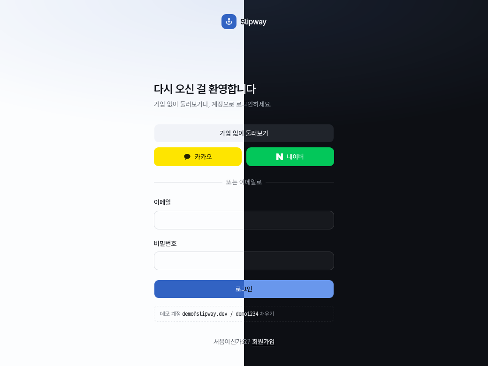
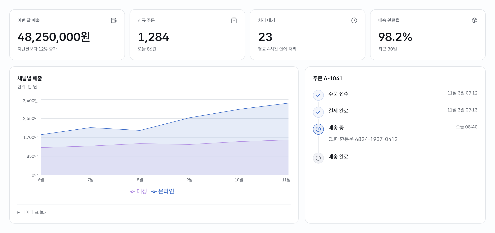
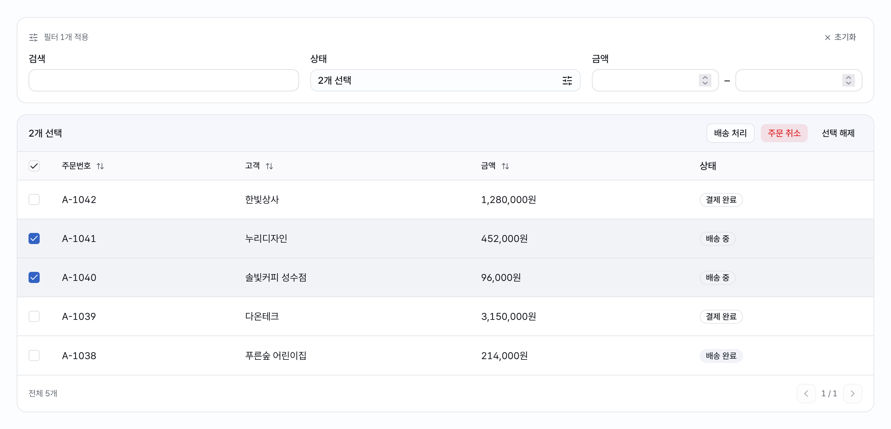
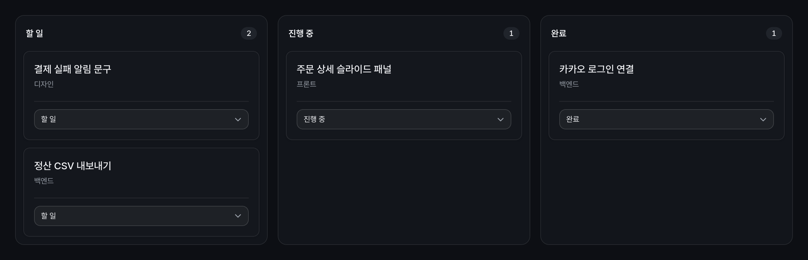

<div align="center">

# Slipway

**제품까지 가는 셋업 코드**

React · NestJS · 모노레포 프리셋과 화면 패턴 20개, AI 작업 하네스

    



</div>

```sh
node scripts/create-project.mjs ../my-app --name "주문 관리"
cd ../my-app && corepack pnpm install --frozen-lockfile && corepack pnpm dev
```

서버도 DB도 API 키도 없이 바로 뜹니다. 같은 코드에 실제 API를 붙이면 그대로 제품이 됩니다.

## 들어 있는 것

| 영역 | 기본으로 들어 있는 것 |
|---|---|
| **인증** | 이메일 · 게스트 · 카카오 · 네이버. scrypt 해시, bearer 세션 |
| **API 계약** | 브라우저 Mock(MSW)과 Nest 서버가 같은 `/api/*`. `VITE_API_URL` 하나로 전환 |
| **DB** | Drizzle + PGlite(설치 없음) 또는 Postgres. 마이그레이션은 시작 시 적용 |
| **UI** | shadcn 63개, Tailwind CSS 4, Pretendard. 브랜드 색은 토큰 하나 |
| **한국어** | 전화번호 · 사업자번호 · 금액 · 주소 입력, zod 한국어 오류 메시지 |
| **검증** | 타입 · 린트 · 단위 · 요구사항 · 빌드 · E2E를 `pnpm verify` 한 줄로 |

## 프리셋

| `--preset` | 구성 | 쓰는 때 |
|---|---|---|
| `react` 기본 | Vite · TanStack Router · TanStack Query · MSW | 프론트부터 빠르게 |
| `mono` | `apps/web` + `apps/api` + `packages/shared`, Turborepo | 웹과 API를 한 저장소에서 |
| `nest` | NestJS · Drizzle · PGlite/Postgres | API만 |

업무 화면은 넣어 두지 않았습니다. 로그인 · 회원가입 · 설정 · <kbd>Ctrl</kbd> <kbd>K</kbd> 빠른 이동까지가 기본이고,
나머지는 아래 패턴으로 조립합니다.

## 화면 패턴







<sub>패턴만 조합한 화면입니다. 데이터는 예시이고, 원본은 <code>templates/react/fixtures/gallery/</code>에 있습니다.</sub>

```sh
node scripts/pack.mjs list
node scripts/pack.mjs show table form
node scripts/pack.mjs copy table form --to ../my-app/src
```

| 분류 | 패턴 ID |
|---|---|
| **목록** | `table` `advanced-table` `filters` `board` |
| **입력** | `form` `wizard` `date-range` `files` `kr-inputs` |
| **보기** | `details` `metrics` `chart` `timeline` |
| **상태** | `async-state` `confirm` |
| **데이터** | `csv` `csv-utils` `kr-format` `api-client` |
| **테마** | `theme` |

패턴은 값과 콜백만 받습니다. 직접 API를 부르거나 데이터를 바꾸지 않습니다.
`copy`는 필요한 파일만 따라가서 복사하고, 내 파일과 겹치면 아무것도 쓰지 않고 멈춥니다.
생성한 프로젝트에는 이미 들어 있으니 바로 import하면 됩니다. → [패턴 사용법](docs/codepack.md)

## AI 하네스

| 장치 | 하는 일 |
|---|---|
| `AGENTS.md` | 프리셋마다 구조와 규칙, 화면 · API 추가 순서 |
| `REQ-n` | 요구사항 ↔ 라우트 ↔ E2E 테스트 연결. 하나라도 빠지면 `check:reqs` 실패 |
| `pnpm verify` | 끝났다고 말하기 전에 돌리는 한 줄 |
| `pnpm shots` | 데스크톱 · 모바일 × 라이트 · 다크 캡처. AI가 결과 화면을 직접 보고 고침 |

<details>
<summary><b>Slipway 자체를 고칠 때</b></summary>

<br>

원본은 `templates/react`와 `templates/nest`입니다. 고친 뒤 `node scripts/sync-mono.mjs`로 mono를 다시 만듭니다.
패턴은 [`codepack/catalog.json`](codepack/catalog.json)에 입력 · 출력 · 의존성과 함께 등록하고,
동작은 앱과 분리된 `fixtures/parts/`에서 테스트합니다.

```sh
node scripts/pack.mjs check
corepack pnpm --dir templates/mono install --frozen-lockfile
corepack pnpm --dir templates/mono --filter @slipway/web exec playwright install firefox
corepack pnpm verify
```

Node.js 22.23.4 이상, pnpm 10.33.2. → [개발 · 검증 기준](docs/feature-workflow.md) · [제품 기준](PRODUCT.md)

</details>
